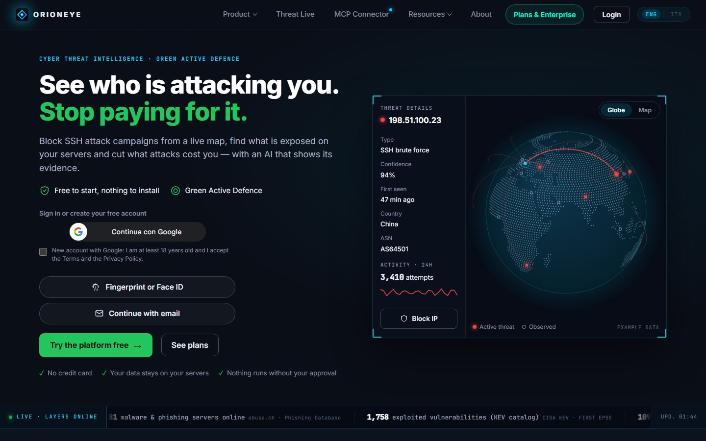
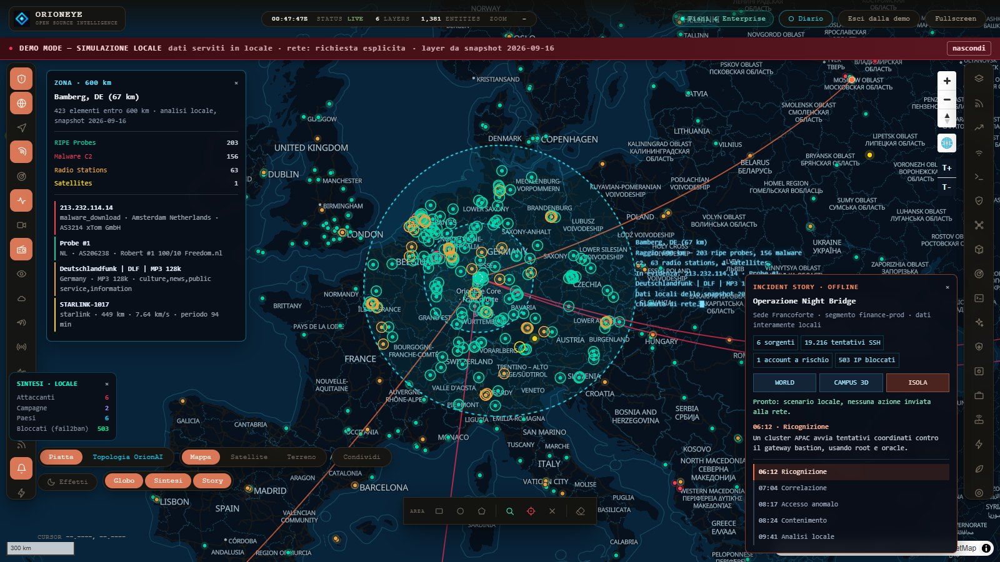
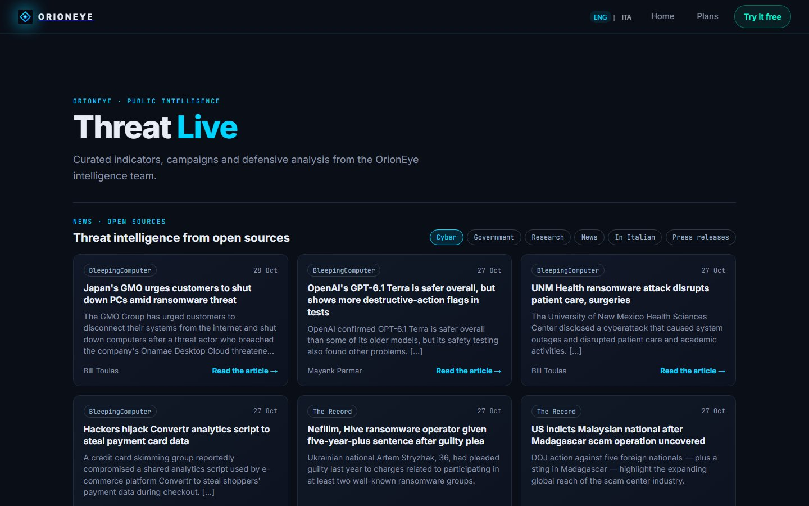
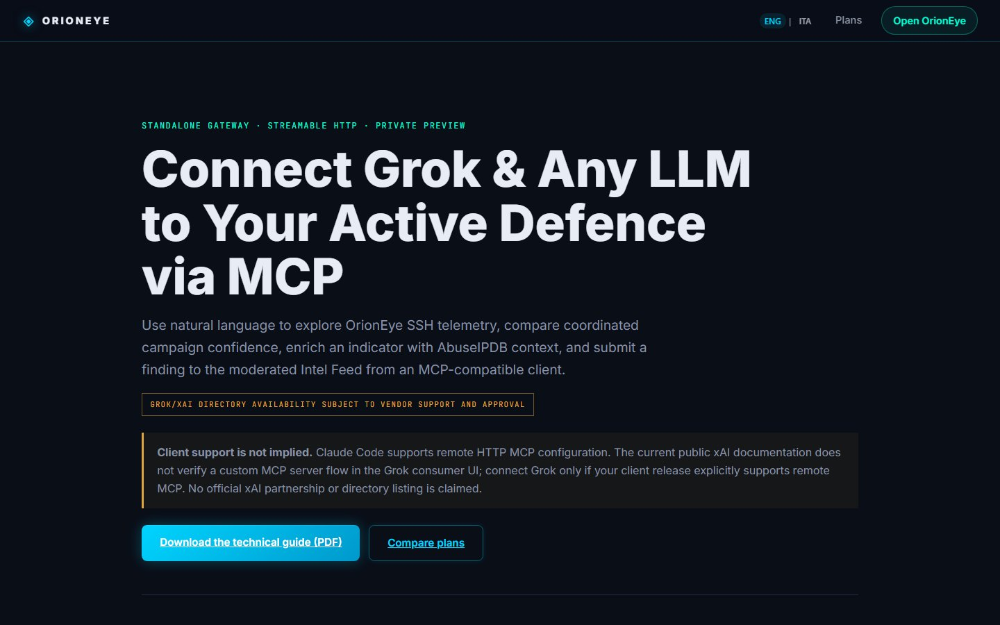
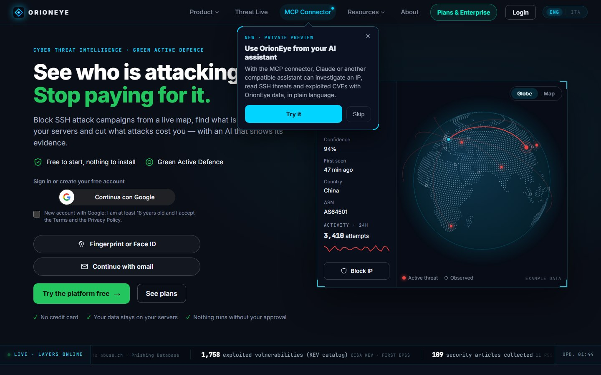
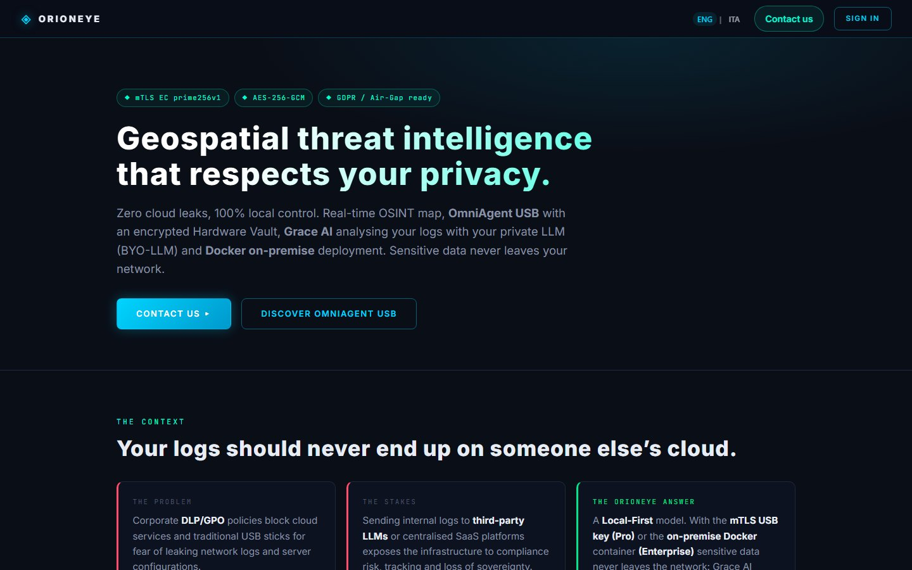
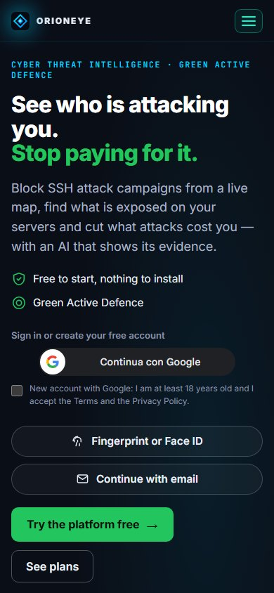

# OrionEye v4.0

### Geospatial threat intelligence and active defence, local-first

**OrionEye shows who is attacking your servers on a live map, groups the attackers into campaigns
and helps you stop them, with a person approving every change.**

[Live site](https://orioneye.io/) · [Threat Live](https://orioneye.io/landing/threat-live.html) · [MCP connector](https://orioneye.io/landing/mcp-connector.html) · [Plans](https://orioneye.io/landing/piani.html) · [Real case](https://orioneye.io/landing/caso-reale.html)

> This is a showcase repository: it documents the platform. The source code is proprietary and is not published here.

---

## In production today

Numbers from the production database and the published case study, read on **27 October 2026**.

| Number | What it is |
|---|---|
| **29,582** | SSH login attempts recorded on our servers since 4 August 2026 |
| **2,290 · 115** | attacking addresses tracked · countries they came from |
| **513** | automatic blocks carried out by the defence rules |
| **5,000 → 12** | SSH attempts per day on a client server, before and after blocking (0 successful logins) |
| **13 → 0** | vulnerable packages on our server, closed in one evening by the patch sentinel |
| **21** | data layers on the map, each with its declared source |
| **96** | tools the AI assistant can use on the map and the platform |
| **138,413** | lines of proprietary code in 8 components; all 197 open-source dependencies use permissive licences |

---

## The problem

Every server on the internet is probed thousands of times a day by programs looking for a weak password.
The evidence exists, but it sits in a log file nobody reads, while it quietly costs CPU and energy.
Whoever investigates a suspicious address opens five different portals and copies the results by hand.

## What OrionEye does

| Step | |
|---|---|
| **1 · Detect** | Failed logins appear on the map the moment they arrive. |
| **2 · Investigate** | One address, opened: where it comes from, who runs the network, its reputation, what it exposes. |
| **3 · Correlate** | Scattered addresses become one coordinated campaign, with a confidence score and the reasons. |
| **4 · Respond** | Block the whole campaign on your own servers, report it to public databases, share it with other analysts. |

The app in public demo mode (sample data, no account needed): area analysis on the left, incident story on the right.

---

## Three products, one family

| | | |
|---|---|---|
| **OrionEye** | *the radar* | The platform in the browser: a world map where sources switch on, an AI that reads them, and tools to defend servers. |
| **OmniAgent OS** | *the hands* | The agent that runs on the customer's computer, also from the Pro USB key. It connects to their servers over SSH, reads them and defends them. |
| **SentraLink** | *the stethoscope* | The local network console: reads routers and devices read-only (128 router profiles), measures the line, checks the PC's security and Wi-Fi. |

Above all three sits a person: **the system proposes, the operator says yes or no.**

---

## Key features

| Feature | What it does | Plan |
|---|---|---|
| **Map and 21 layers** | 3D globe, map, satellite, terrain. Malware C2 servers, aircraft, satellites, natural events, webcams, earthquakes, cyclones, news, submarine cables. | Free |
| **Orion AI** | Ask in plain language; the AI reads the active layers and answers with data, using 96 tools. Pro can compare several models side by side. | Free · Pro |
| **Attackers and campaigns** | Memory of who attacks your servers, including the "new" ones no public list knows; attackers grouped into botnet campaigns; one-click campaign block. | Pro |
| **Automation with brakes** | Rules that act on their own, with a 24-hour simulation, never-block networks, an hourly limit, a log with undo and a "stop everything" switch. | Pro |
| **Investigator** | Give it a goal ("is PHP vulnerable? fix it"): it investigates read-only, checks its hypotheses and proposes the fix. Nothing changes on a server without your yes. | Pro |
| **Patch sentinel** | Compares the server's packages with Ubuntu security notices and the catalogue of exploited vulnerabilities (KEV), with the fix command already written. | Admin |
| **Uncover Engine** | One question to several reconnaissance engines at once (Shodan, Censys, AbuseIPDB…), one record per address with who answered and who did not. | Pro · Enterprise |
| **AI layer and alerts** | Watch topics such as "ransomware" or a malware family; alerts keep running with the page closed and arrive by email. | Free |
| **Investigation diary** | Records a session and turns it into a report with map snapshots and a slide in MP4, PDF and HTML. | Free |
| **Key vault** | AI and service keys are encrypted in your browser with a phrase only you know: the server stores only ciphertext. | Free |
| **Threat Live** | Public page: news from 11 security sources, the vulnerabilities actually exploited (CISA KEV + EPSS), active C2 servers, and "Investigate" straight into the map. | Public |
| **MCP connector** | Lets Claude and other compatible assistants query OrionEye in plain language. Private preview; blocking is never done through MCP. | Pro · Enterprise |
| **Pro USB key** | Passwordless login with the certificate on the key (mTLS) and an encrypted vault that opens only on your machine. A copied key does not work. | Pro |

<table>
<tr>
<td width="50%"> Threat Live: curated news, exploited CVEs and active C2 servers.</td>
<td width="50%"> The MCP connector page.</td>
</tr>
</table>

---

## Use OrionEye from your AI assistant (MCP)

The **MCP connector** (Model Context Protocol) lets an assistant such as Claude use OrionEye's tools:
read resources, investigate an IP against public lists, read SSH threats, check exploited CVEs, search places
and send a finding to the moderated Intel Feed.

- **Pro:** 2 clients, investigation tools. **Enterprise:** the full set.
- Blocking actions stay proposals for the operator to approve: **fail2ban is never driven from MCP.**
- Status: **private preview.** [Details and technical guide →](https://orioneye.io/landing/mcp-connector.html)

New on the home page: MCP has its own menu entry, and first-time visitors get a card that points to it (Try it / Skip).

---

## Plans

Three tiers, each one a verb.

| | **Free · Explore** | **Pro · Investigate** | **Enterprise · Defend** |
|---|---|---|---|
| For | Anyone over 18 who wants to look | Security specialists, sysadmins, SMEs | SOCs, critical infrastructure, isolated networks |
| Sign-in | Email and password, or Google | USB key, no password | Signed licence, installed at the customer (Docker) |
| Adds | Map, open sources, Orion AI, Intel Feed (read) | OmniAgent and SentraLink, server defence, Uncover, multiple AI models | Everything in Pro, local AI models, works without internet |
| Where data lives | On our server, like any online service | The part about your infrastructure stays on your machine | Nothing leaves the company |

Pro and Enterprise are sold to businesses only. [Compare the plans →](https://orioneye.io/landing/piani.html)

**Where does the data go?** Logs stay on the customer's servers, read by OmniAgent. If the customer chooses a cloud
AI model, what they ask goes to that model; with Enterprise the models run locally. We don't say "zero cloud": we say what goes where.

<table>
<tr>
<td width="72%"></td>
<td width="28%"></td>
</tr>
</table>

---

## Technology

| Layer | Technologies |
|---|---|
| Front end | TypeScript, Vite, MapLibre GL (map and WebGL globe), Cytoscape (topology graphs), hls.js (live streams) |
| Back end | Node.js, SQLite (better-sqlite3), Redis cache, Pino logging, rate limiting |
| Sign-in | Email and password, Google, passkeys (WebAuthn), USB key with mTLS client certificate |
| AI | Gemini by default; OpenAI, Claude, Mistral, Groq, DeepSeek, OpenRouter on the customer's key; Ollama for local models |
| Defence | fail2ban and nftables on the protected servers, driven by OmniAgent with local safety rules that always win |
| Voice | Piper neural text-to-speech, self-hosted |
| Deployment | VPS behind nginx for the SaaS; Docker on the customer's premises for Enterprise |

Languages: the app and site are in English and Italian; legal pages also in German.

---

## Who builds it

**Lowegate Studio**, a small team in Germany. The person who writes the product is also the person who answers when you ask how it works.

| | |
|---|---|
| **Samuel La Manna** | Founder, CEO and Lead Architect: designed and wrote OrionEye |
| **Juljan Hebibasi** | Business & Investor Relations |
| **Carmelo Bellia** | Managing Director & Head of Operations, FoodLink |
| **Angela** | SEO & Digital Content Strategist |

- Web: [orioneye.io](https://orioneye.io/) · [lowegatestudio.de](https://www.lowegatestudio.de/)
- Email: [contact-orioneye@lowegatestudio.de](mailto:contact-orioneye@lowegatestudio.de)
- LinkedIn: [Samuel La Manna](https://www.linkedin.com/in/samuel-l-a499341b5/)

---

## Disclaimer

> This repository contains documentation and screenshots only: no source code is published.
> OrionEye is proprietary software of Lowegate Studio (Samuel La Manna). All rights reserved © 2024–2026.
> Screenshots were taken from the live site on 28 October 2026; the app screenshot uses the public demo with sample data.
